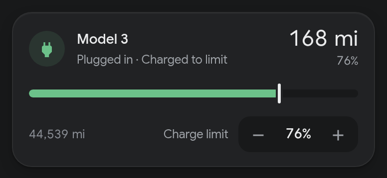
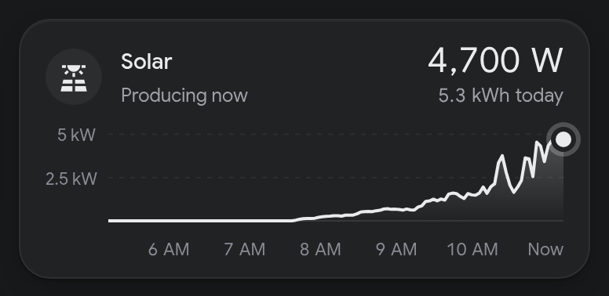

# Minimal Energy Cards

Two Home Assistant dashboard cards, an EV charging card and a solar production card. They're designed to match the
[Minimal Dark](https://github.com/theak/minimal-dark-ha-theme) theme but take their colors from whatever theme you use.
The file has no dependencies.

| EV card | Solar card |
|---|---|
|  |  |

## Install

**HACS:** add `https://github.com/theak/minimal-energy-cards` as a custom repository of type **Dashboard**, then
install **Minimal Energy Cards**. HACS adds the dashboard resource for you.

**Manual:** copy `minimal-energy-cards.js` into `config/www/` and add `/local/minimal-energy-cards.js` as a JavaScript
module resource (Settings → Dashboards → ⋮ → Resources).

## EV card

The card shows range in large type, battery percentage, a charge bar with a marker at the charge limit, and the charge
state:

- **Charging:** green, with charge power and time to the limit when those sensors are set.
- **Plugged in:** green, "Not charging" or "Charged to limit".
- **Unplugged with a low battery** (under `low_battery`, 40% by default): red, "Battery low".
- **Unplugged otherwise:** off-white.

The − / + buttons change the charge limit in steps of 5%. Quick taps are combined into one service call, so the car
isn't woken up once per tap.

```yaml
type: custom:minimal-ev-card
name: Model 3
range: sensor.my_car_range
battery: sensor.my_car_battery
charge_limit: number.my_car_charge_limit
charging: binary_sensor.my_car_charging
plugged: binary_sensor.wall_connector_vehicle_connected
power: sensor.wall_connector_power
complete_time: sensor.my_car_time_charge_complete
odometer: sensor.my_car_odometer
```

| Option | Required | Description |
|---|---|---|
| `range` | yes | Range sensor; its unit is shown |
| `battery` | yes | Battery level sensor (%) |
| `name` | no | Card title (default `Car`) |
| `charge_limit` | no | `number` entity for the charge limit; adds the stepper and the bar marker |
| `charging` | no | `binary_sensor` that is `on` while charging |
| `plugged` | no | `binary_sensor` that is `on` while the cable is connected |
| `power` | no | Charge power sensor in kW |
| `complete_time` | no | Timestamp sensor for when charging finishes |
| `odometer` | no | Odometer sensor |
| `low_battery` | no | Battery % below which an unplugged car shows the low color (default `40`) |

## Solar card

The card shows current production, energy produced today and a graph of the last few hours. Drag across the graph to
read the power at any moment. Time labels fall on whole hours and are spaced to fit the card's width, so they don't
overlap. "Today" is worked out from the sensor's history since midnight in Home Assistant's time
zone, so you don't need a separate energy sensor.

```yaml
type: custom:minimal-solar-card
name: Solar
entity: sensor.solar_power
hours: 6
```

| Option | Required | Description |
|---|---|---|
| `entity` | yes | Solar power sensor in W or kW (needs recorder history) |
| `name` | no | Card title (default `Solar`) |
| `hours` | no | Hours of history in the graph (default `6`) |
| `graph` | no | `false` hides the graph and shows just the numbers (default `true`) |

## Colors

Set these CSS variables in your theme, or on a card with card-mod:

| Variable | Default |
|---|---|
| `--minimal-ev-color` | `#6cc28a` (plugged in or charging) |
| `--minimal-ev-low-color` | `#e82127` (unplugged, battery low) |
| `--minimal-ev-idle-color` | `var(--primary-text-color)` (unplugged) |
| `--minimal-solar-color` | `var(--primary-text-color)` |

Everything else uses the standard theme variables (`--primary-text-color`, `--secondary-background-color` and so on).
